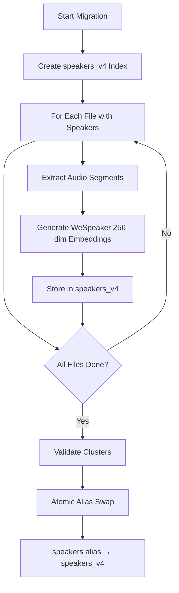

# PyAnnote v3 to v4 Migration

## Overview

OpenTranscribe includes a streamlined migration process for upgrading from PyAnnote v3 to v4 speaker embeddings. This upgrade brings significant performance improvements, enhanced accuracy, and new features for speaker analysis.

### Why Migrate?

PyAnnote v4 is the speaker embedding model the native diarization engine uses (WeSpeaker ResNet34-LM, 256-dimensional). Migrating moves your existing speaker data onto it:
- **Lite deployments need it.** A lite install serves speaker embeddings only through the native sidecar, which speaks v4 (see the warning under [Prerequisites](#prerequisites)).
- **One embedding space.** New files already produce v4 embeddings; migrating re-extracts the old ones so speaker matching compares like with like.

Migration is a data conversion, not a speed switch. Earlier versions of this page quoted speed-up and accuracy figures for it; none were measured on the migration, so they were removed.

### What Changes?

| Aspect | PyAnnote v3 | PyAnnote v4 |
|--------|-------------|-------------|
| Embedding model | `pyannote/embedding` | WeSpeaker ResNet34-LM |
| Embedding Dimension | 512 | 256 |
| OpenSearch index | `speakers_v3` | `speakers_v4` |

### Alias-Based Index Architecture

Since v0.3.3, OpenSearch speaker indices use an alias-based architecture:

- **`speakers_v3`**: Concrete index with 512-dim embeddings (PyAnnote v3 / pyannote/embedding model)
- **`speakers_v4`**: Concrete index with 256-dim embeddings (WeSpeaker/PyAnnote v4)
- **`speakers`**: An OpenSearch alias that points to the currently active versioned index

Finalization (switching from v3 to v4) is an atomic alias swap -- no data copy or downtime. The alias is created automatically on startup. All application code reads/writes through the `speakers` alias, so the switch is transparent.

#### Why Alias-Based Architecture?

The alias-based design was chosen to solve a fundamental problem: v3 embeddings (512-dim) and v4 embeddings (256-dim) are mathematically incompatible and cannot coexist in the same HNSW index. A naive migration approach would require either:

1. **Reindex-and-swap**: Build a complete new index, then delete the old one. This risks data loss if the process fails midway and requires double the storage during migration.
2. **In-place migration**: Delete all documents and re-insert with new dimensions. This causes downtime and breaks any in-flight queries.

The alias approach avoids both problems. Both `speakers_v3` and `speakers_v4` indices exist simultaneously, each with their own HNSW graph configuration optimized for their respective dimensionalities. The `speakers` alias acts as a stable pointer that all application code references. Migration proceeds as follows:

1. New embeddings are written to `speakers_v4` in batches as files are reprocessed.
2. The old `speakers_v3` index remains fully operational for reads during migration.
3. When migration completes, a single atomic OpenSearch API call swaps the alias:

```
POST /_aliases
{
  "actions": [
    { "remove": { "index": "speakers_v3", "alias": "speakers" } },
    { "add":    { "index": "speakers_v4", "alias": "speakers" } }
  ]
}
```

This swap is atomic -- there is zero downtime and no window where queries could fail.

⚠️ The reverse swap is **mechanically** possible in the same way, but is **not exposed as an
operation**: `swap_speaker_alias()` has one production caller (the migration task) and is only
ever passed the v4 index. There is no endpoint, task, or UI that swaps back, so do not plan
around "instant rollback" -- see [Rollback](#rollback-if-needed) and issue
[#659](https://github.com/attevon-llc/OpenTranscribe/issues/659).

Key functions implementing this architecture: `swap_speaker_alias()`, `get_active_versioned_index()`, and `get_write_index()` in the OpenSearch service layer.

### Embedding Consistency Self-Healing

The system includes automatic repair for speaker embedding inconsistencies:
- Detects mismatches between database speaker records and OpenSearch embeddings
- Runs every 10 minutes under a run lease: the check renews it while it detects and dispatches, each repair batch renews it per file, and only the batch that finishes the run releases it, so a running repair is never restarted. A run that stops renewing (crashed or stopped) loses the lease after 2 hours
- Each repair batch carries only its own files' speakers (at most 25 files and 400 speakers), so a large library cannot fill Redis with repair messages
- Files that failed to repair are left out of scheduled checks for 24 hours; a manual Repair retries them
- Repairs orphaned, missing, or stale embeddings automatically
- Can be triggered manually via the Admin UI (Settings → Data & Storage → Speaker Embedding System)

### Timeline

Duration depends on library size and hardware: it re-extracts embeddings from the audio of every file that has speakers. The Speaker Embedding System tab shows an estimate once the migration starts. Plan for hours rather than minutes on a library of hundreds of files, and run it off-peak.

Migration runs in the background, but **transcription is paused while it runs** so the GPU can re-extract embeddings; uploads made meanwhile are queued and resume automatically when the migration finishes.

## Prerequisites

Before starting the migration process, verify these requirements:

:::warning[Lite deployments: migrate to v4 before running lite]
As of issue #660, a **lite** deployment (`DEPLOYMENT_MODE=lite`) ships neither
`pyannote.audio` nor `torchaudio` — speaker embeddings there are served
exclusively by the diar-native CPU-EP sidecar, which only speaks v4 (256-dim).
A lite install still holding **v3** (512-dim) speaker data cannot extract any
speaker embeddings at all until it migrates: the service refuses at
construction with an actionable error rather than crashing on a missing
in-process model. Complete this migration on a full (non-lite) deployment
first, then switch to `--lite`.
:::

### Check Current Version

View your current embedding version in the admin UI:
1. Open **Settings** and choose **Data & Storage**, then the **Speaker Embedding System** tab (super admin)
2. **Current Mode** shows V3 (`pyannote/embedding`, 512-dim) or V4 (WeSpeaker ResNet34-LM, 256-dim), with the **V3 Documents** and **V4 Documents** counts
3. When the system is still on V3, an **Upgrade Available: V4 Mode** card offers **Start Migration**

### Disk Space Requirements

Migration recalculates all speaker embeddings, requiring temporary disk space:

- **Model cache**: ~500MB (PyAnnote speaker models)
- **Embedding storage**: Variable (depends on number of speakers/segments)
  - Estimate: ~1-2MB per transcribed hour
  - For 100 transcribed hours: 100-200MB additional storage
- **Buffer**: Recommend 1-2GB free space for safety

Check available disk space:
```bash
df -h /var/lib/docker/volumes  # Docker volumes
docker exec opentranscribe-backend df -h /app  # Inside container
```

### Processing Time Availability

- Migration runs **asynchronously** in the background
- **Transcription is paused** while it runs; new uploads are queued and process automatically afterwards
- You can still browse existing transcripts and use the rest of the application
- Avoid restarting the backend during active migration

### Backup Recommendations

There is no supported one-click rollback (see [Rollback](#rollback-if-needed)), so:

1. **Backup your database** before starting:
   ```bash
   ./opentr.sh backup          # or ./opentranscribe.sh backup
   ```

2. **Document current speaker data** if you have custom speaker assignments

## Migration Process

### Migration Workflow



### Starting the Migration

1. Open the **Admin UI** in your browser (http://localhost:5173) as a super admin
2. Navigate to **Settings** → **Data & Storage** → **Speaker Embedding System**
3. Click **Start Migration**
4. Migration begins and the **Migration Progress** card appears

### Monitoring Progress

The card shows "Processing N of M files", a progress bar, and the estimated time. If some files cannot be processed it offers **Retry Failed Files** and **Skip & Mark Complete**. **Stop Migration** halts it. When all files are processed, click **Finalize Migration** to swap the indices.

### During Migration

While migration is in progress:

**What you can do:**
- Upload new files (they are queued and process when the migration finishes)
- Browse existing transcripts
- Access the admin UI and all features
- Check real-time migration progress

**What to avoid:**
- Don't restart the backend (migration will resume on restart, but may slow down)
- Don't manually modify speaker data during migration
- Don't delete files being migrated (wait until migration completes)

### Estimated Completion Times

There is no measured table for the migration itself. The time scales with the hours of audio in files that have speakers, the GPU, and whether other work competes for it. Read the live estimate on the **Migration Progress** card, and watch the files-processed count for a few minutes to project your own total.

## What Gets Updated

- **Speaker embeddings.** For every file with speakers, the voice embedding is re-extracted from the audio with the v4 model (256 dimensions) and written to `speakers_v4`.
- **Speaker profile voiceprints.** Finalizing backfills the profile (consolidated voiceprint) documents into `speakers_v4`, then validates counts and swaps the `speakers` alias.
- **Recordings where speaker recognition is turned off** (by the owner's or the organization's privacy setting) are skipped and get no voiceprints. The Speaker Embedding System tab lists how many are skipped before you start.

### Data Preservation

- Transcripts, speaker names, speaker assignments and your edits are not touched. They live in PostgreSQL and the migration does not rewrite them.
- The v3 index (`speakers_v3`) stays in OpenSearch after the swap, but nothing reads it and no supported operation switches back to it (see [Rollback](#rollback-if-needed)).

## Rollback (if needed)

:::danger There is no supported one-click rollback today — issue #659

Earlier versions of this page described two ways to revert to v3: an Admin UI control at
*Settings → Data & Storage → Speaker Embedding System → "Use PyAnnote v3"*, and a `PYANNOTE_VERSION=v3` environment variable.
**Neither exists.** No such control is in the embedding-migration settings component, and
`PYANNOTE_VERSION` is read by nothing — it appears in no `.env.example`, no compose file, and
no application config. Setting it does nothing at all.

Because that text was written as an *emergency fallback*, it was at its most dangerous exactly
when it would be read: mid-incident, by an operator who needs the migration undone now. It is
removed rather than softened.

**Restoring from a backup taken before the migration is the only supported rollback.** See
[Data Recovery](#data-recovery) below, and take that backup before you start.

Tracking issue: [#659](https://github.com/attevon-llc/OpenTranscribe/issues/659) — a real
rollback path is planned for v0.8.0.
:::

### Why the alias swap is not a rollback button

The architecture section above notes that the `speakers` alias can point at either versioned
index, and that swapping it is atomic. That is true of the *mechanism* — but the mechanism is
not reachable as an operation. `swap_speaker_alias()` has exactly one production caller (the
migration task itself) and is only ever passed the v4 index. There is no endpoint, no Celery
task, and no UI that swaps it back.

**You are not forced through a one-way door in this release**: the migration is
superuser-opt-in (`POST /embedding-migration/start`, then `/finalize`), nothing on the beat
schedule dispatches it, and an upgrade leaves the alias on v3. If you have not started it, you
are not exposed to the missing rollback.

### What a restore gets you back

- v3 speaker embeddings, as of the backup
- The migration can be restarted later

### Data Recovery

If you need to restore from backup:

1. **Restore database from backup**:
   ```bash
   ./opentr.sh restore backups/backup_before_migration.sql   # or ./opentranscribe.sh restore <file>
   ```

2. **Restart backend**:
   ```bash
   ./opentr.sh restart-backend
   ```

## FAQ

### Can I skip migration?

**Short answer**: Migration is optional but highly recommended.

**Should you migrate?**
- Yes, if you plan to run the lite deployment (it needs v4 speaker data)
- Yes, if you want all speaker data in the embedding space the current diarizer produces
- No, if you do not need either; v3 data keeps working

**System behavior without migration:**
- PyAnnote v3 continues working as before
- New files use the embedding version the `speakers` alias points at (v3 until you finalize)
- No data loss or compatibility issues if you skip migration

### How long will migration take?

It depends on the hours of audio in files that have speakers, the GPU, and system load (disk I/O and other running work slow it). The estimate on the **Migration Progress** card is the figure to use. Avoid starting it just before a busy period: transcription is paused for the duration.

### Will this affect existing transcripts?

No. Transcript text, timestamps, speaker names and your speaker assignments are unchanged. Only the stored voice embeddings are recalculated, so speaker suggestions and cross-file speaker matching can differ slightly afterwards.

### Can I use both v3 and v4 simultaneously?

Not as a configuration. Both `speakers_v3` and `speakers_v4` exist while a migration runs, but the `speakers` alias points at exactly one of them, and every read and write goes through it. There is no environment variable that selects a version: `PYANNOTE_MODE`, `PYANNOTE_VERSION` and `PYANNOTE_FALLBACK` are read by nothing. The version in use is whichever index the alias points at, shown as **Current Mode** under Settings, Data & Storage, Speaker Embedding System.

### What if migration fails?

**Automatic recovery:**
- Migration is atomic per file (completes or rolls back)
- Failed files are logged and can be retried
- System continues processing other files
- No data loss occurs

**Troubleshooting:**
1. Check backend logs for specific errors:
   ```bash
   docker logs opentranscribe-backend | grep -i migration
   ```

2. Common issues:
   - Disk space: Ensure 2GB+ free space
   - Memory: Restart backend if OOM errors
   - GPU memory: Reduce `GPU_SCALE_WORKERS` if using GPU scaling

3. Retry migration:
   - Click **Retry Failed Files** on the Speaker Embedding System tab to process the failed files again
   - **Skip & Mark Complete** finishes without them; those files then have no v4 embeddings and speaker matching may not work for them

4. Contact support if migration fails consistently and provide:
   - Backend logs (last 100 lines)
   - System specifications (GPU, RAM, CPU)
   - Library size (number of files)
   - Error messages from the Speaker Embedding System tab
