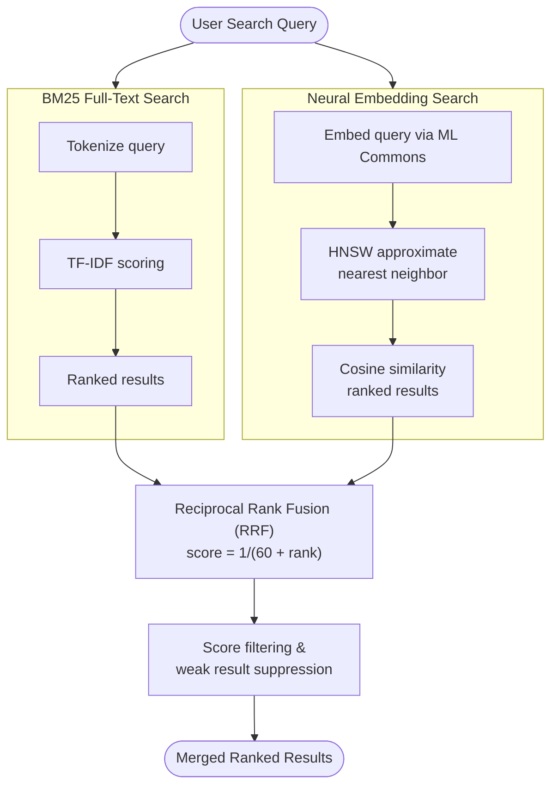

# OpenSearch Neural Search Setup

Neural search enables AI-powered semantic search capabilities in OpenTranscribe, allowing users to find transcripts based on meaning and context rather than just keywords.

## Overview

**What is Neural Search?**

Neural search uses machine learning embeddings to understand the semantic meaning of text. Instead of matching keywords, it finds conceptually similar content across transcripts.

**Examples:**
- Search for "financial reporting procedures" finds mentions of "quarterly earnings calls" and "budget reviews"
- Search for "meeting organizer" finds references to "facilitator", "moderator", "lead coordinator"
- Search for "action items" finds TODO discussions even if the word "action" isn't used

**Why It Matters:**
- Improves recall by finding related content traditional search misses
- Works across synonyms, paraphrases, and different phrasings
- Complements full-text search for comprehensive coverage

:::tip[Hybrid Search]
OpenTranscribe combines BM25 full-text search with neural search using Reciprocal Rank Fusion (RRF). This gives you the speed of keyword search plus the intelligence of semantic search.
:::

### Why Hybrid Search Beats Either Approach Alone

Keyword search (BM25) excels at exact matches -- names, dates, technical terms -- but fails when users phrase queries differently from the transcript. Neural search catches synonyms and paraphrases but can return false positives for conceptually adjacent but irrelevant content. The hybrid approach ensures both signals contribute:

- A document ranked #1 in keyword search and #5 in semantic search scores higher than one ranked #3 in both, because RRF rewards strong signal in either dimension.
- Documents appearing in both result lists get a natural boost, surfacing the most confidently relevant matches.
- Semantic-only results face additional filtering: those in the lowest 20% of the semantic score range are suppressed (`SEARCH_SEMANTIC_SUPPRESS_RATIO`), and remaining results must exceed a minimum score threshold (`SEARCH_HYBRID_MIN_SCORE`). This prevents low-confidence semantic matches from diluting precise keyword results.

In practice, hybrid search eliminates the "I know it's in there but I can't find it" problem common with keyword-only search on conversational transcripts, where speakers rarely use the exact terms a user would search for.

## Prerequisites

Before enabling neural search, ensure:

- **OpenSearch 3.4.0+** - Required for ML Commons plugin
- **ML Commons Plugin Enabled** - For model management and embeddings
- **Sufficient OpenSearch heap** -- the embedding model runs on CPU inside the OpenSearch
  JVM and never touches the GPU, so the cost is heap, not VRAM. 1 GB runs the default
  model; 2 GB runs every English model, including the 768-dimension ones. See
  [Performance Tuning](../operations/performance-tuning.md#opensearch-heap-what-it-is-actually-for).
- **Available Disk Space**: ~80-480 MB per model, depending on which you select

:::note[Model Download]
Models are downloaded automatically on first use. Ensure your OpenSearch container has internet access during initial setup.
:::

## Available Models

OpenTranscribe offers seven embedding models, every one of them verified to register,
deploy, and return its declared dimension from a real prediction against
`opensearch:3.4.0`. Only models OpenSearch itself provides can be listed here -- a name
that merely exists on Hugging Face fails registration at every version.

| Model | Tier | Dim | Languages |
|---|---|---|---|
| `all-MiniLM-L6-v2` *(default)* | Fast | 384 | English |
| `all-MiniLM-L12-v2` | Fast | 384 | English |
| `multi-qa-MiniLM-L6-cos-v1` | Fast | 384 | English |
| `paraphrase-multilingual-MiniLM-L12-v2` | Fast | 384 | 50+ |
| `all-mpnet-base-v2` | Balanced | 768 | English |
| `all-distilroberta-v1` | Best | 768 | English |
| `distiluse-base-multilingual-cased-v1` | Best | 512 | 15 |

Sizes, measured cross-lingual scores, and the warning about adding a model live in the
[Admin Panel guide](../user-guide/admin-panel.md#embedding-model-selection).

:::info[Dimension is what makes a switch expensive]
Moving between models of the *same* dimension is a re-embed. Changing dimension
**recreates the index**. Four of the seven are 384-dimension, matching the default, so
switching between them is the cheap and reversible path.
:::

### Model Selection Rationale

The default `all-MiniLM-L6-v2` was chosen for several specific reasons:

- **Latency**: At 2-5ms per embedding, it adds negligible overhead to the indexing pipeline and keeps search response times under 50ms even on large indexes. The 768-dim models (mpnet, distilroberta) take 3-4x longer per embedding.
- **Memory**: At 80MB and 384 dimensions, the HNSW vector index stays small. A 10,000-transcript deployment with ~50,000 chunks uses ~73MB of vector index memory with 384-dim vs ~147MB with 768-dim.
- **Transcript search characteristics**: Meeting transcripts are conversational English with limited vocabulary diversity. The accuracy gap between MiniLM-L6 and larger models is smaller on this domain than on academic benchmarks, because the semantic space is narrower.
- **Multilingual alternative**: For non-English deployments, `paraphrase-multilingual-MiniLM-L12-v2` provides 50+ language coverage at the same 384-dim footprint (420MB model, same embedding speed tier).

Changing models requires a full reindex of all transcripts, as the vector dimensions and semantic space differ between models.

## Configuration Steps

### Step 1: Open Search & Indexing

1. Sign in as an administrator
2. Open **Settings**, then **Data & Storage**, then the **Search & Indexing** tab
3. The page shows **Index Health**, the active **Embedding Model**, and the re-index controls

### Step 2: Neural search is on by default

Neural search is controlled by `OPENSEARCH_NEURAL_SEARCH_ENABLED` (default `true`; `false` falls back to keyword-only search). There is no on/off toggle in the page. At startup the backend registers and deploys the default model in OpenSearch's ML Commons.

:::warning[Neural search is degraded]
If the model cannot be prepared, the page shows a **Neural search is degraded** banner with the last error and the time of the next automatic retry. Keyword search keeps working. A common cause is too little OpenSearch JVM heap; see Prerequisites.
:::

### Step 3: Select an Embedding Model

1. Open the **Embedding Model** dropdown. Each entry shows its dimension and download size, the one in use is marked `(Current)`, and a model that is not yet on OpenSearch is marked **Not downloaded**.
2. Pick one of the seven models listed above.
3. For a model that is not downloaded, click **Download & deploy** and wait for "Model downloaded and deployed. You can apply it now."
4. Click **Apply & Re-index**, or **Cancel** to keep the current model. Applying re-embeds every document, so the button only appears once you change the selection.

:::note[Initial setup]
Fetching and deploying a model can take several minutes depending on its size and the connection. Monitor the OpenSearch and backend logs (`./opentr.sh logs opensearch`) if it seems stuck.
:::

## Performance Tuning

### Embedding batch size

The embedding model runs on CPU inside OpenSearch, so GPU memory does not limit it. Documents sent per embedding call are set by `SEARCH_NEURAL_BATCH_SIZE` (default 5), and chunks per bulk request by `SEARCH_BULK_BATCH_SIZE` (default 100); both are environment variables listed in [Environment Variables](./environment-variables.md#search-and-indexing-tuning). Lower them if OpenSearch runs out of heap while indexing.

### Hybrid Search Pipeline



### Hybrid Search Strategy

OpenTranscribe uses **Reciprocal Rank Fusion (RRF)** to combine results:

**How It Works:**
1. BM25 full-text search returns top matches
2. Neural search returns semantically similar results
3. RRF merges rankings for balanced relevance

**RRF Formula**: `score = 1/(k + rank)`, with `k` = `SEARCH_RRF_RANK_CONSTANT` (default 30)

**Example:**
- User searches: "quarterly business review"
- BM25 finds: "Q3 earnings call", "financial summary report"
- Neural finds: "performance assessment meeting", "progress update discussion"
- Merged results show all related content

**Tuning:** there are no BM25 or neural weights in the Settings UI. The fusion strategy and its parameters (`SEARCH_FUSION_STRATEGY`, `SEARCH_RRF_RANK_CONSTANT`, `SEARCH_RRF_WINDOW_SIZE`, `SEARCH_COMBINATION_WEIGHTS`, ...) are environment-only measurement knobs; RRF is the default because no alternative won in testing. See [Environment Variables](./environment-variables.md#fusion-strategy--measurement-knobs-deliberately-env-only) before changing any of them.

## Reindexing Transcripts

When you change models, you must reindex existing transcripts:

### Automatic Batch Indexing

1. Go to **Settings**, then **Data & Storage**, then **Search & Indexing**
2. Click **Re-index All Transcripts** (or **Apply & Re-index** after choosing a new model)
3. The page shows progress while re-indexing runs, and a **Stop** button

### Progress Monitoring

- Progress and the last re-index time are shown on the **Search & Indexing** tab
- View logs: `./opentr.sh logs opensearch`
- Task state: Flower at `http://localhost:5175/flower`
- Speed depends on the model and CPU; measured about 3.2 documents/second for the multilingual model on the OpenSearch CPU node

:::note[Large Indexes]
For thousands of transcripts, reindexing runs in the background and search stays available, using keyword-only mode while re-indexing is in progress.
:::

### Incremental Indexing

New transcripts are automatically embedded when uploaded. Only use **Re-index All Transcripts** when:
- Neural search was previously disabled
- Changing embedding models
- Recovering from indexing errors

### Recovering Text-Only Files From a Neural Search Outage

If the neural search backend is briefly unavailable (a slow or cold OpenSearch ML boot), files
transcribed during that window are indexed as full-text only — they have no embedding vector and
are excluded from neural/hybrid search until re-embedded.

**The bootstrap itself self-heals automatically.** A background task retries neural search
availability on a backoff, so new uploads resume getting embeddings again without any admin
action once the backend recovers.

**Files already indexed during the outage need one manual step.** They don't get an embedding
added later on their own. To recover them:

1. Go to **Settings** → **Data & Storage** → **Search & Indexing**
2. If any files were left text-only, a banner reports the affected file count (separate from the
   "neural search degraded" bootstrap banner — a file can be stuck here even after the backend
   itself has fully recovered)
3. Click **Re-embed Degraded Files**
4. Confirm in the dialog, which shows the file and user counts affected
5. Progress reports through the same reindex notification as **Re-index All Transcripts**

:::note[Large Backlogs]
The preview can be truncated on very large backlogs. If the banner says so after a re-embed
completes, run **Re-embed Degraded Files** again to catch the remaining files.
:::

## Frontend Features

### User Search Interface

The search page has two modes:

- **Smart** (default): semantic plus keyword search, ranked by RRF. A **Semantic on** indicator shows when the neural model is active.
- **Exact**: keyword-only search for exact matches.

When the neural model is not deployed the page shows **Keyword only** and Smart mode behaves as keyword search. Filters (speaker, date, tags, collections) apply to both modes. Results found only through meaning carry a **Semantic** badge; results matched both ways are marked as such.

:::note[Admin Setting]
Model selection is an administrator feature (Settings, Data & Storage, Search & Indexing). Users only see the results.
:::

## Backend & Infrastructure

### Architecture

**Neural Search Pipeline:**

```
Upload Transcript
    ↓
Store in MinIO
    ↓
Index in OpenSearch (BM25 full-text)
    ↓
Embedding Generation (ML Commons)
    ↓
Store Vector Index (HNSW)
    ↓
Ready for Hybrid Search
```

**Key Components:**
- **ML Commons**: OpenSearch plugin for model management -- registers, deploys, and serves embedding models server-side so the backend sends raw text and receives vectors without loading models itself
- **ONNX Runtime**: Fast inference engine for embeddings
- **HNSW**: Hierarchical Navigable Small World graph for approximate nearest neighbor search
- **RRF**: Reciprocal Rank Fusion for result merging

#### HNSW Vector Indexing

The vector index uses HNSW (Hierarchical Navigable Small World) with these parameters:

| Parameter | Value | Purpose |
|-----------|-------|---------|
| `ef_construction` | 256 | Build-time quality (higher = more accurate index, slower build) |
| `m` | 16 | Number of bi-directional links per node (higher = better recall, more memory) |
| Similarity | Cosine | Distance metric for comparing embeddings |

These settings prioritize search recall over index build speed, which is appropriate because transcripts are indexed once (during post-processing) but searched many times. The index is also sorted by `file_uuid` + `chunk_index` to optimize the collapse-by-file grouping used in search results.

#### Server-Side Embeddings via ML Commons

OpenTranscribe generates embeddings server-side within OpenSearch rather than in the backend application. Documents are sent as raw text through an OpenSearch ingest pipeline that automatically calls the deployed ML model to generate vector embeddings during indexing. This eliminates network round-trips for embedding generation, ensures consistency (one model version across all indexed documents), and keeps the embedding model out of the backend's memory footprint.

### API Endpoints

The search administration endpoints live under `/api/search` (`GET /models/neural`, `POST /models/neural/{name}/register`, `POST /models/neural/{name}/deploy`, `PUT /models/neural/active`, `GET /models/neural/status`, `POST /reindex`, `POST /reindex/stop`, `GET /reindex/status`, `GET /index-health`, `POST /repair-indices`, `GET /degraded-embeddings`, `POST /reembed-degraded`). The search itself is `GET /api/search` with `search_mode=hybrid|keyword`. Interactive documentation is at `/api/docs` where `ENABLE_API_DOCS` allows it.

## Troubleshooting

### Issue: Models Not Discovered

**Symptoms**: Model dropdown appears empty or shows "No models available"

**Causes**:
- OpenSearch not running
- ML Commons plugin not enabled
- Network connectivity issue

**Solutions**:
1. Verify OpenSearch is running:
   ```bash
   ./opentr.sh status | grep opensearch
   ```

2. Check ML Commons enabled:
   ```bash
   curl -s http://localhost:5180/_plugins/_ml/models | jq .
   ```

3. Check backend logs:
   ```bash
   ./opentr.sh logs backend | grep -i "neural\|embedding"
   ```

4. Restart backend:
   ```bash
   ./opentr.sh restart-backend
   ```

### Issue: Embedding Generation Errors

**Symptoms**: Status shows "Error generating embeddings" or "Model failed to load"

**Error Messages & Solutions:**

| Error | Cause | Solution |
|-------|-------|----------|
| "Out of memory" / "Allocation failure" | Too little OpenSearch JVM heap for the model | Raise `OPENSEARCH_JAVA_OPTS` (Xms = Xmx) or pick a smaller model |
| "Model not found" / "not downloaded" | Model registration failed | Use **Download & deploy** again from Settings, Data & Storage, Search & Indexing |
| "Timeout exceeded" | Model too slow | Select a faster model or lower `SEARCH_NEURAL_BATCH_SIZE` |

**Debugging Steps**:
1. Check OpenSearch logs:
   ```bash
   ./opentr.sh logs opensearch | grep -i error
   ```

2. Monitor CPU and memory (the embedding model does not use the GPU):
   ```bash
   docker stats opentranscribe-opensearch
   ```

3. Check the model status on Settings, Data & Storage, Search & Indexing: a banner explains a degraded model and its last error.

### Issue: Search Performance Problems

**Symptoms**: Search queries are slow or timing out

**Possible Causes & Solutions:**

| Symptom | Cause | Solution |
|---------|-------|----------|
| Slow hybrid search | Large index + heavy load | Check OpenSearch CPU and heap |
| Slow semantic search | Model too large | Switch to a smaller model (all-MiniLM) |
| Timeout errors | Long request queue | Check OpenSearch load and the backend logs |
| High memory usage | Index too large | Raise the OpenSearch heap, consider archiving |

**Optimization Steps**:
1. Check index size:
   ```bash
   curl -s http://localhost:5180/_cat/indices?v | grep transcript
   ```

2. Compare **Exact** (keyword) and **Smart** (hybrid) mode on the same query to see which leg is slow.

### Issue: Memory Issues

**Symptoms**: "Out of memory", "Allocation failure", or crashes

**Quick Fixes**:
1. Reduce the embedding batch size in `.env`:
   ```bash
   SEARCH_NEURAL_BATCH_SIZE=2   # default 5
   ```

2. Switch to a smaller model: Settings, Data & Storage, Search & Indexing, **Embedding Model**, `all-MiniLM-L6-v2`

3. Give OpenSearch more heap (Xms must equal Xmx) in `.env`:
   ```bash
   OPENSEARCH_JAVA_OPTS=-Xms4g -Xmx4g
   ```

### Issue: Reindexing Stuck

**Symptoms**: Reindex status shows "In Progress" for hours

**Solutions**:
1. Check background task queue: open `http://localhost:5175/flower`

2. Check container resources:
   ```bash
   docker stats opentranscribe-opensearch
   ```

3. Cancel (if needed): click **Stop** on the Search & Indexing tab (`POST /api/search/reindex/stop`)

4. Restart OpenSearch (`opentr.sh` has no single-service restart for OpenSearch, so this
   restarts everything):
   ```bash
   ./opentr.sh restart-all
   ```

## Offline & Airgapped Setup

OpenSearch registers the embedding model from an artifact mounted into the container, so an air-gapped host needs the model files before it disconnects.

1. On an internet-connected machine, run the model downloader from a repository checkout. It writes the OpenSearch model artifacts to `models/opensearch-ml/` (mounted at `/ml-models` in the OpenSearch container) along with the other models:

   ```bash
   export HUGGINGFACE_TOKEN=hf_your_token_here
   DOWNLOAD_ALL_OPENSEARCH_MODELS=true ./scripts/download-models.sh ./models
   # or pick models: OPENSEARCH_MODELS="all-MiniLM-L6-v2,all-mpnet-base-v2" ./scripts/download-models.sh ./models
   ```

2. Copy the whole `models/` directory to the offline machine (or use `scripts/build-offline-package.sh`, which does this for you) and set `MODEL_CACHE_DIR` to it.

3. Start OpenTranscribe. The model is registered from `/ml-models` with no network access.

See [Offline Installation](../installation/offline-installation.md) for the complete air-gapped procedure.

:::note[Model sync]
To add a model later, download it on a connected machine (step 1), copy the new files into `models/opensearch-ml/` on the offline machine, then choose it under **Embedding Model** and **Apply & Re-index**.
:::

## Advanced Configuration

### Using Custom Models

Only the seven models listed under Available Models can be selected. A model that merely exists on Hugging Face fails registration in OpenSearch, so adding one needs code changes (the model catalog in the backend) and a verification run against a throwaway OpenSearch cluster, as described in the [Admin Panel guide](../user-guide/admin-panel.md#embedding-model-selection).

### Scaling to Large Indexes

For deployments with 10,000+ transcripts:

- **Model**: `all-MiniLM-L6-v2` (fast)
- **OpenSearch heap**: raise `OPENSEARCH_JAVA_OPTS` (4 GB is the default; never more than 50% of RAM)
- **Indexing**: see [Search and Indexing Tuning](./environment-variables.md#search-and-indexing-tuning) for `SEARCH_BULK_BATCH_SIZE`, `REINDEX_PARALLEL_WORKERS` and the retry/sweep settings

## Next Steps

- [Search & Filters User Guide](../user-guide/search-and-filters.md) - How users interact with search
- [Performance Optimization](../operations/performance-tuning.md) - Advanced tuning
- [Troubleshooting](../installation/troubleshooting.md) - General system issues
