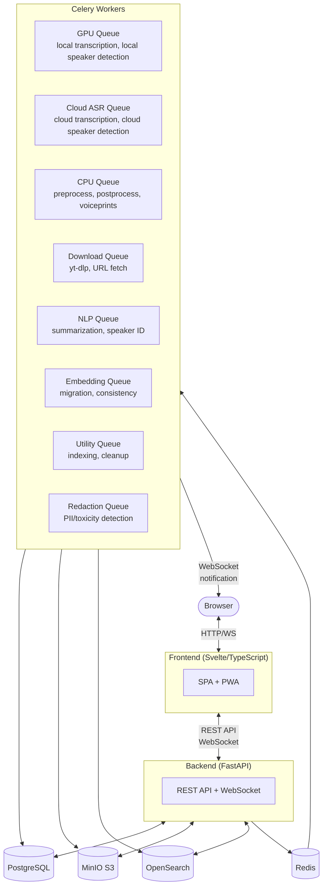
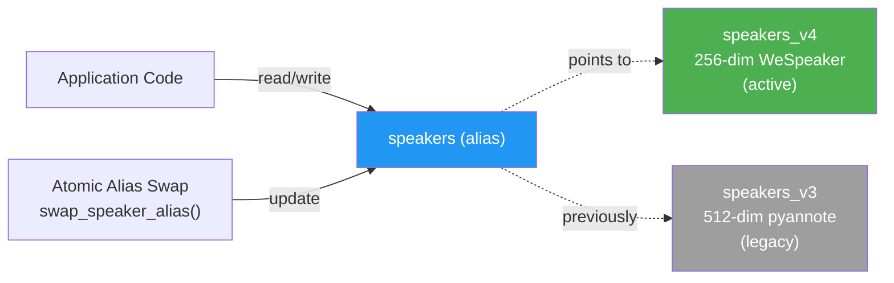
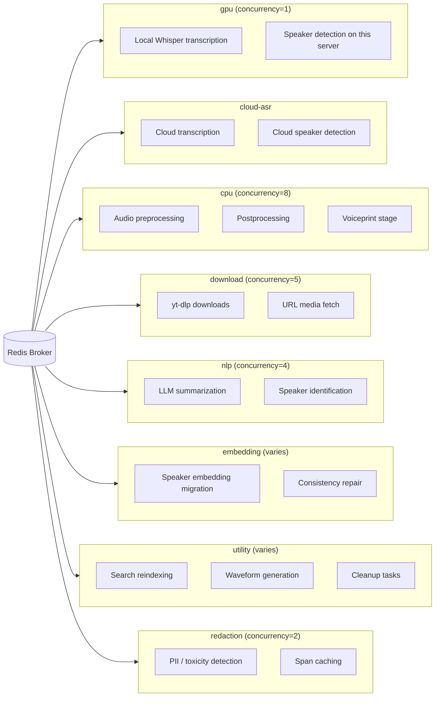

# Architecture

OpenTranscribe is built with a modern, scalable architecture designed for modularity and GPU efficiency.

## System Overview



## System Components

### Frontend (Svelte)
- Progressive Web App with TypeScript
- Responsive design with light/dark mode
- Real-time WebSocket updates
- Shared UI component library (`src/components/ui/`): BaseModal, Spinner, ProgressBar, SkeletonLoader

### Backend (FastAPI)
- Async Python with RESTful API
- OpenAPI documentation
- WebSocket support for real-time progress
- Modular shared modules:
  - `app/core/enums.py` — centralized FileStatus enum (single source of truth)
  - `app/core/exceptions.py` — custom exception hierarchy (`OpenTranscribeError` base)
  - `app/core/redis.py` — shared Redis singleton via `get_redis()` (process-wide, lazily created)
  - `app/services/interfaces.py` — Protocol interfaces for Storage, Search, Cache, Notification
  - `app/services/notification_service.py` — unified `send_task_notification()` wrapper
  - `app/utils/transcript_builders.py` — shared transcript formatting functions
  - `app/services/progress_tracker.py` — EWMA-based ETA for all long-running tasks

### Workers (Celery)
- **GPU Queue**: Local Whisper transcription and this server's speaker detection (concurrency=1)
- **Cloud ASR Queue**: Cloud transcription providers and cloud speaker detection (pyannote.ai, or a vendor used only for its speakers)
- **CPU Queue**: Audio preprocessing, postprocessing, the voiceprint stage (concurrency=8). The same worker also drains `cpu-transcribe` (lightweight per-file Whisper models) and `utility`
- **Download Queue**: YouTube/URL downloads
- **NLP Queue**: LLM features (summarization, speaker ID)
- **Embedding Queue**: Speaker embedding extraction
- **Utility Queue**: Maintenance, error handlers
- **Redaction Queue**: PII / toxicity / profanity detection (dedicated `celery-redaction` CPU service)

### Data Layer
- **PostgreSQL**: Relational data with Alembic-only migrations (no init_db.sql)
- **MinIO**: S3-compatible object storage with private buckets and optional AES-256-GCM encryption at rest
- **OpenSearch 3.4.0**: Full-text and vector search with alias-based speaker indices
- **Redis**: Task queue broker and caching singleton

## Transcription Pipeline

Transcription and speaker detection are chosen independently, and each can run on this server
or at a cloud vendor. One pure function decides how a file is processed, and every stage
follows its answer. Which combinations each image supports is listed in
[Deployment Variants](../installation/deployment-variants.md).

### The plan: one decision point

`services/pipeline_plan.py` `resolve_pipeline_plan(PlanInputs) -> PipelinePlan` takes the
user's transcription choice, their speaker-detection choice, the deployment (full or lite),
the model's capabilities from the ASR catalog and the admin's local engine, and returns:

- **Transcription**: `local_gpu`, `local_cpu` (a lightweight per-file model) or `cloud`, the
  queue it runs on, and the timing the model returns (`word`, `segment` or `none`).
- **Speaker detection**: which detector runs (`asr` = the transcription vendor's own speakers,
  `local` = this server, `pyannote_ai`, `asr_config` = another saved provider used only for
  its speakers, or `off`) and how (`inline_asr`, `inline_local`, `parallel_cloud`,
  `post_stage_local`, `post_stage_cloud`, `none`).
- **Voiceprints**: always computed on this server (`inline_native` after this server's
  engine, otherwise `embedding_stage` on the `cpu` queue). A vendor's voiceprints are never used.
- **Issues**: each with a stable code and a fixed sentence. Only `error` severity blocks.

`services/pipeline_plan_inputs.py` gathers the inputs. The same resolver answers
`GET /api/user-settings/pipeline` (the read-only pipeline view in Settings) and validates
settings changes, so what Settings shows cannot disagree with what runs.

There is no forced-alignment step and no wav2vec2 alignment model: local Whisper produces word
timestamps itself, and a cloud model that returns no timestamps is refused for every speaker
detector rather than aligned after the fact.

### The chain

`tasks/transcription/dispatch.py` resolves the plan **once** per run. A plan with a blocking
issue is refused before anything is published: the file goes to ERROR with the issue's fixed
sentence. Otherwise the plan travels in the chain context (`plan.to_context()`) and every
stage reads it from there:

```
preprocess (cpu)
  → transcribe (gpu | cpu-transcribe | cloud-asr)
  → postprocess (cpu)
      → post stage: rediarize_task (cloud-asr for a vendor, gpu for this server)
      | voiceprint stage (cpu)
      | inline voiceprints (no extra task)
```

1. **Preprocess** (`cpu`): downloads the media, extracts and normalizes audio with FFmpeg,
   stages the WAV for the next stage, and reads media metadata.
2. **Transcribe** on the plan's queue:
   - `gpu`: local Whisper (faster-whisper with word timestamps). When the plan says
     `inline_local`, this server's speaker detection runs in the same task and returns
     per-speaker vectors. With the optional gpu-split topology the two halves run on
     `gpu-transcribe` and `gpu-diarize`.
   - `cpu-transcribe`: a lightweight per-file Whisper model.
   - `cloud-asr`: a cloud vendor. With `inline_asr` the vendor's own speakers are used; with
     `parallel_cloud` a cloud detector runs beside the transcription in the same task.
3. **Postprocess** (`cpu`) indexes the transcript, dispatches downstream work (summary, topics,
   speaker attributes) and hands speaker work to one of:
   - the **post stage** when the plan says `post_stage_local` or `post_stage_cloud`:
     `rediarize_task` with the plan's detector, on `cloud-asr` for a vendor (no GPU slot is
     held while the vendor works) or on the GPU queue for this server's engine. It re-splits
     the saved segments at speaker changes and then runs the voiceprint step. A vendor failure
     is not fatal: the transcript is kept and the failure is recorded.
   - the **voiceprint stage** (`embedding_stage`, `cpu`) for speakers that came from a cloud
     vendor without vectors.
   - **inline voiceprints** (`inline_native`), matched right in postprocess from the vectors
     the GPU stage returned.

Each run has exactly one completion and metering terminus: postprocess when nothing was handed
off, otherwise the stage it handed off to.

### One merge, one voiceprint interface

- **Speaker assignment** has one implementation, `transcription/speaker_assigner.py`
  `assign_speakers(..., granularity="word" | "segment")`, used by the GPU stage, the cloud task
  and the post stage. Segment-timed models are merged at segment granularity, so a speaker
  change inside a segment is not detected (the plan reports this as a warning).
- **Voiceprints** go through `services/voiceprint_extractor.py`:
  `extract(audio_path, turns) -> Voiceprints` (256-d WeSpeaker vectors per speaker), served by
  the diar-native sidecar's `/embed_window` with an in-process fallback.
  `get_voiceprint_extractor()` is the seam a replacement implementation plugs into.

### Per-file provenance

Every stage that completes a step records which provider and model ran it and where, through
one writer, `services/file_provenance.py` `record_stage` (stored in
`media_file.processing_provenance`). One reader, `services/file_provenance_view.py`
`build_processing_steps`, serves it as `processing_steps` on the file detail and file status
endpoints. Files processed before recording began are shown as not recorded, never guessed.

### Lite deployments

`docker-compose.lite.yml` sets `DEPLOYMENT_MODE=lite` on every service and scales both GPU
workers (`celery-worker`, `celery-worker-gpu-scaled`) to `replicas: 0`. The plan therefore
never schedules local transcription or this server's speaker detection there: those choices are
refused with a fixed sentence (`local_asr_unavailable`, `local_diarization_unavailable`, or
`automatic_needs_speaker_provider` for Automatic with a text-only model) before any task is
published. Cloud transcription and cloud speaker detection run on `cloud-asr`, and voiceprints
are still computed locally by the voiceprint stage on `cpu`.

### Pipeline Benefits
- **GPU never idles**: While GPU processes file N, CPU preprocesses file N+1
- **Batch efficiency**: For 1000+ files, CPU queue (concurrency=8) prepares multiple files ahead
- **Error isolation**: Postprocess failures don't lose transcription data (segments already saved)
- **No GPU held for cloud work**: cloud transcription and cloud speaker detection run on `cloud-asr`

### Error Handling
- Each stage has its own error handler for status updates
- A chain-level `link_error` callback (`on_pipeline_error`) ensures cleanup even if a task's internal handler fails
- Temp audio is always cleaned up (in `finally` block)

## Speaker Index Architecture



OpenSearch speaker indices use an alias-based architecture for zero-downtime version upgrades:

- **`speakers_v3`**: Concrete index, 512-dim embeddings (PyAnnote v3 / pyannote/embedding)
- **`speakers_v4`**: Concrete index, 256-dim embeddings (WeSpeaker/PyAnnote v4)
- **`speakers`**: OpenSearch alias pointing to the active versioned index

Migration between versions uses atomic alias swaps — no data copying required. The alias is created automatically on startup via `migrate_to_alias_based_indices()`.

## Embedding Consistency Self-Healing

The system includes automatic repair for speaker embedding inconsistencies:
- Detects mismatches between database speaker records and OpenSearch embeddings
- Runs periodic consistency checks with a distributed lock (2-hour TTL)
- Repairs orphaned, missing, or stale embeddings automatically
- Triggered on startup and via admin UI

## Database Management

All schema changes use **Alembic migrations** exclusively:
- No `init_db.sql` — the database is bootstrapped entirely through Alembic
- Migrations run automatically on backend startup
- Idempotent SQL (`IF NOT EXISTS`) for safety
- Migration detection logic in `app/db/migrations.py`

## Architecture Design Decisions

### Why the Modularization

The codebase underwent a major modularization refactor to address concrete maintainability issues identified during a code quality audit:

- **Duplicated UI patterns**: 13 modal components independently implemented identical backdrop, container, close button, and animation CSS (~1,500-2,000 duplicated lines). These were consolidated into `BaseModal.svelte` and the shared `src/components/ui/` library.
- **Scattered infrastructure code**: Redis connections were created ad-hoc across multiple files, risking connection leaks. The `app/core/redis.py` singleton ensures one connection per process with lazy initialization.
- **Notification fragmentation**: WebSocket notifications were sent through inconsistent patterns across tasks. The `notification_service.py` wrapper provides a single `send_task_notification()` entry point with structured payloads.
- **Circular import risk**: Enums like `FileStatus` were defined in model files and imported circularly. Centralizing in `app/core/enums.py` (re-exported from `models/media.py` for backward compatibility) eliminated this class of error.
- **Oversized files**: Several files exceeded 800-2,900 lines, making them difficult to review and test. The refactor split `speaker_tasks.py` into three focused modules (`speaker_identification_task.py`, `speaker_update_task.py`, `speaker_embedding_task.py`) with a thin re-export shim for backward compatibility.

### Protocol-Based Interfaces

The `app/services/interfaces.py` module defines Python `Protocol` classes for Storage, Search, Cache, and Notification services. This dependency inversion pattern allows tasks and services to depend on abstract interfaces rather than concrete implementations, enabling easier testing and future provider swaps (e.g., switching from MinIO to AWS S3).

### 8-Queue Celery Architecture



Tasks are separated into queues by resource type to prevent resource contention:

| Queue | Concurrency | Why Separate |
|-------|-------------|--------------|
| `gpu` | 1 | GPU memory is exclusive; concurrent GPU tasks cause OOM |
| `cloud-asr` | 16 (`CLOUD_ASR_CONCURRENCY`) | Network-bound cloud transcription and cloud speaker detection, no GPU needed |
| `cpu` | 8 | CPU-bound preprocessing, postprocessing and the voiceprint stage should not block GPU |
| `download` | 5 | Network-bound downloads with rate limiting |
| `nlp` | 4 | LLM API calls are network-bound, separate from transcription |
| `embedding` | varies | Speaker embedding extraction, can be CPU or GPU |
| `utility` | varies | Maintenance tasks, error handlers, reindexing |
| `redaction` | 2 | PII / toxicity / profanity detection on a dedicated CPU service; isolates the redaction ML models from the GPU worker |

This separation ensures GPU workers are never blocked waiting for a download to complete, and CPU-intensive postprocessing does not compete with GPU transcription for worker slots.

#### Content Redaction Service

Content redaction (PII, profanity, and toxicity moderation) runs on the dedicated `celery-redaction` CPU service following a **detect-once / cache-forever** model. Detection runs exactly once per transcript on this worker — the only worker that loads the PII (Presidio + GLiNER) and toxicity (Tiny-Toxic / XLM-R) models, keeping those weights off the GPU worker. The resulting spans are cached on `transcript_segment.redactions` and `transcript_segment.toxicity`, so detection never re-runs unless segment text is edited or an admin upgrades a model.

Masking itself is a **read-time transform** (`services/redaction/spans.py:apply_redactions`) applied at every display and export surface (API formatting, subtitle/SRT/VTT/TXT exports, and redact-before-LLM). The full original transcript is always retained in the database; enabling/disabling redaction, changing categories, style, custom words, or the allowlist only changes how the cached spans are rendered — never the stored text.

### Redis Singleton Pattern

The `get_redis()` function in `app/core/redis.py` returns a process-wide, lazily-created Redis connection. Before this consolidation, multiple modules created their own `redis.Redis()` instances, which led to connection pool exhaustion under load. The singleton pattern ensures at most one connection per process (using Redis database 0 for application data), with proper cleanup on shutdown.

## Deployment Models

- Development: docker-compose with hot reload (Vite dev server)
- Production: docker-compose with NGINX reverse proxy, CSP headers
- Offline: Airgapped deployment with pre-cached models
- Cloud: AWS/GCP/Azure with GPU instances
- Lite: cloud-only transcription and speaker detection, no GPU required; voiceprints are still computed locally on CPU

See [Deployment Variants](../installation/deployment-variants.md) for what each image can run.

## Next Steps

- [Deployment Variants](../installation/deployment-variants.md)
- [Contributing](./contributing.md)
- [Docker Compose Installation](../installation/docker-compose.md)
