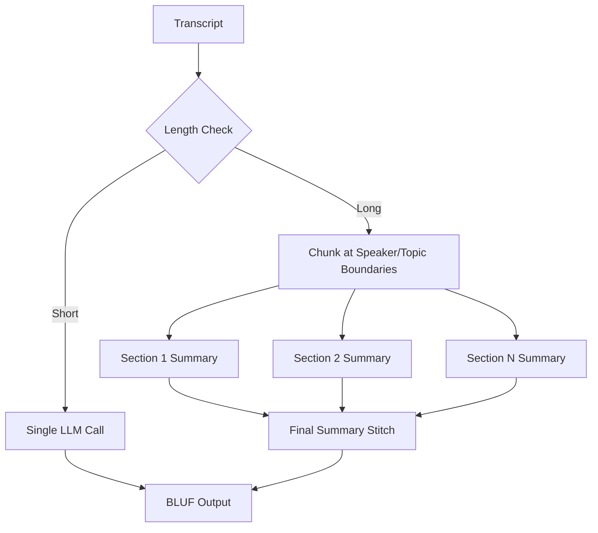
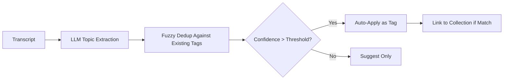

# AI Summarization

OpenTranscribe generates AI-powered summaries of your transcripts using Large Language Models (LLMs).

## Overview

AI summarization provides:
- **BLUF Format**: Bottom Line Up Front executive summaries
- **Speaker Analysis**: Talk time, key contributions by speaker
- **Action Items**: Extracted with priorities and assignments
- **Key Decisions**: Important conclusions and agreements
- **Follow-up Items**: Next steps and pending tasks

## Requirements

- LLM provider configured (see [LLM Integration](../features/llm-integration.md))
- Completed transcription with or without speakers
- Sufficient LLM API credits (for cloud providers)

## Generating Summaries

### From Web UI

1. Open the file from the gallery
2. Click **Generate AI Summary** in the file's action row
3. Wait for AI processing; the button then reads **AI Summary** and opens the summary
4. To regenerate with a different prompt, choose one in the summary dialog (**Use active prompt** or one of your prompts) and click **Regenerate**

### AI Summarization Pipeline



### Automatic Processing

For long transcripts, OpenTranscribe automatically:
- Splits content into sections at speaker/topic boundaries
- Processes each section independently
- Stitches results into cohesive summary
- Handles transcripts of any length

## Summary Formats

### BLUF (Default)

Bottom Line Up Front format includes:

**Executive Summary**:
- 2-3 sentence overview
- Key takeaways
- Critical information first

**Speaker Analysis**:
- Talk time percentage
- Key contributions
- Speaking patterns

**Action Items**:
- Task description
- Priority (High/Medium/Low)
- Assigned person (if mentioned)
- Due date (if mentioned)

**Key Decisions**:
- Important conclusions
- Agreements reached
- Changes approved

**Follow-up Items**:
- Pending questions
- Future discussions
- Next steps


### Custom Prompts

Create custom summarization prompts for specific use cases:
- Meeting notes format
- Interview analysis
- Podcast highlights
- Legal deposition summaries
- Medical consultation notes

### Organization Context

You can configure **organization context** (Settings → Organization Context, under **AI & Chat**) that is automatically injected into AI prompts. This provides the LLM with background information about your organization, improving summary relevance:

- Describe your organization, team structure, or domain
- Choose whether to include context with system prompts (**Include with system prompts**), your custom prompts (**Include with custom prompts**), or both
- Up to 10,000 characters of context text
- The context is per user; you can also share yours with all users (**Share with all users**), and others can adopt a shared one (**Use this**)

### Per-Collection Default Prompts

Collections can have a **default AI prompt** assigned. When generating a summary for a file in that collection, the collection's default prompt is automatically selected:

1. Click **Collections** in the gallery toolbar
2. Create a collection, or click **Edit collection** on an existing one
3. Select a **Default Summary Prompt** (the default is **None (use active prompt)**)
4. Files in the collection will use that prompt by default when generating summaries

This is useful for organizing different types of content (e.g., interviews vs. meetings) that need different summarization approaches.

### Disable AI Summary

Automatic AI summarization can be turned off:

- **Per-upload**: Turn **Generate AI summary** off on the **Options** step of the upload dialog to skip summarization for that file
- **User default**: Go to Settings → LLM Provider Configuration → AI Summary Settings and turn off **Auto-generate summaries** to skip automatic summarization after every transcription
- **System-wide** (administrators): **System-wide AI summaries** in the same place turns summaries off for all users
- When disabled, summaries can still be generated manually by clicking **Generate AI Summary** on any completed transcript

### Auto-Label Pipeline



## Auto-Labeling

When an LLM provider is configured, OpenTranscribe can automatically analyze completed transcriptions and suggest organizational labels:

- **Auto-tag**: AI extracts key topics and applies them as tags
- **Auto-collect**: AI suggests relevant collections based on content
- **Bulk grouping**: When uploading multiple files, AI can group them into collections by topic

Configure auto-labeling in **Settings → Auto-Labeling (Tags & Collections)**:
- Enable/disable the feature globally
- Set confidence threshold for suggestions
- Toggle tags and collections independently
- Run retroactively on existing files

## LLM Providers

### Local LLM (Privacy-First)

Best for sensitive content:

Add a configuration under **Settings → LLM Provider Configuration** (provider vLLM, Ollama or Custom, with the server's base URL). The `.env` variables below are only a fallback; a configuration saved in the UI wins.

```bash
# vLLM or Ollama (fallback defaults in .env)
LLM_PROVIDER=vllm
VLLM_BASE_URL=http://localhost:8012/v1
```

**Advantages**:
- Complete privacy
- No API costs
- Works offline
- Unlimited usage

**Requirements**:
- Dedicated GPU (8GB+ VRAM)
- Model deployment (Llama, Mistral, etc.)

### Cloud LLM

Best for convenience:

```bash
# OpenAI (fallback defaults in .env; the UI configuration wins)
LLM_PROVIDER=openai
OPENAI_API_KEY=sk-xxxxx

# Anthropic Claude
LLM_PROVIDER=anthropic
ANTHROPIC_API_KEY=sk-ant-xxxxx
```

**Advantages**:
- No infrastructure needed
- Latest models
- High quality results

**Considerations**:
- Requires internet
- Per-token costs
- Data sent to provider

## Performance

| Transcript Length | Processing Time (Cloud LLM) | Processing Time (Local LLM) |
|-------------------|------------------------------|------------------------------|
| 30 minutes | 10-15 seconds | 20-40 seconds |
| 1 hour | 20-30 seconds | 40-80 seconds |
| 3 hours | 60-90 seconds | 2-4 minutes |

**Note**: OpenTranscribe intelligently chunks long transcripts, so a 10-hour transcript takes only marginally longer than a 3-hour one.

## Configuration

### Provider Settings


Configure providers in **Settings → LLM Provider Configuration** (**Create Configuration**, then **Activate**). Defaults for a deployment can also be set in `.env`; a configuration saved in the UI takes precedence:

```bash
# Provider selection
LLM_PROVIDER=vllm  # or: openai, anthropic, ollama, openrouter

# Provider-specific
VLLM_BASE_URL=http://localhost:8012/v1
VLLM_MODEL_NAME=meta-llama/Llama-2-70b-chat-hf
OPENAI_API_KEY=sk-xxxxx
ANTHROPIC_API_KEY=sk-ant-xxxxx
```

### Custom Prompts

Create custom prompts in UI:
1. Go to Settings → AI Summarization Prompts
2. Click **Create Prompt**
3. Configure:
   - **Prompt Name**
   - **Content Type** (General, Meeting, Interview, Podcast, Documentary or Speaker Identification)
   - **Description**
   - **Prompt Text** (use the `{transcript}` and `{speaker_data}` placeholders)
4. Save

Use custom prompts:
1. Click **Activate** on a prompt to make it the one used for new summaries, or
2. Open a file's summary, choose the prompt, and click **Regenerate**

A prompt can be shared with all users (**Share with all users**); others see it under **Shared by Others**.

## Best Practices

1. **Review AI Summaries**: Always verify critical information
2. **Speaker Labels Help**: Labeled speakers produce better summaries
3. **Clear Audio**: Better transcription = better summaries
4. **Choose Right Provider**: Local for privacy, Cloud for quality
5. **Custom Prompts**: Tailor summaries to your workflow

## Troubleshooting

### Summary Generation Fails

**Check**:
- LLM provider configured correctly
- API key valid (for cloud)
- LLM server running (for local)
- Sufficient credits (for cloud)

**Solution**:
```bash
# Test LLM connection
./opentr.sh logs celery-worker | grep -i llm
```

Also check that a configuration under **Settings → LLM Provider Configuration** is active (**Currently Active**) and passes **Test Connection**.

### Poor Quality Summaries

**Causes**:
- Weak LLM model
- Poor transcription quality
- Insufficient context

**Solutions**:
- Use larger model (70B+ parameters recommended)
- Improve transcription (use `large-v3` Whisper model for maximum accuracy)
- Add speaker labels for better context

### Slow Processing

**Solutions**:
- Use cloud LLM (faster)
- Upgrade local LLM hardware
- Use smaller model (trade-off with quality)

## Cost Estimates (Cloud)

Approximate costs for cloud LLM providers:

| Transcript Length | OpenAI GPT-4 | Claude Opus | OpenRouter |
|-------------------|--------------|-------------|------------|
| 30 minutes | $0.20-0.40 | $0.25-0.50 | $0.15-0.30 |
| 1 hour | $0.40-0.80 | $0.50-1.00 | $0.30-0.60 |
| 3 hours | $1.20-2.40 | $1.50-3.00 | $0.90-1.80 |

**Note**: Local LLM has zero per-use cost after hardware investment.

## Next Steps

- [LLM Integration](../features/llm-integration.md)
- [Speaker Management](./speaker-management.md)
- [Search & Filters](./search-and-filters.md)
