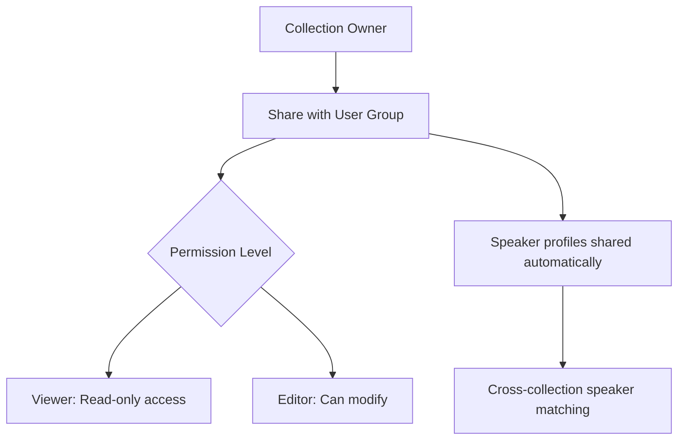

# Collections

Organize related media files into collections for better project management.

## Creating Collections

1. On the gallery, click **Collections** in the toolbar (next to **Tags** and **Add Media**) with nothing selected
2. Click **New Collection**
3. Enter a **Name**
4. Add a **Description** (optional)
5. Optionally choose a **Default Summary Prompt** for the collection (see [Per-Collection Default Prompts](./ai-summarization.md#per-collection-default-prompts))
6. Click **Create Collection**, then add media files: click **Select Files** in the gallery, tick the files, and choose **Organize > Add to Collection**

You can also assign files to collections during upload -- see [Organizing During Upload](./uploading-files.md#organizing-during-upload).

## Use Cases

- **Projects**: Group all meeting recordings for a project
- **Clients**: Organize files by client
- **Events**: Conference sessions
- **Courses**: Lecture series
- **Interviews**: Research interview sets

## Managing Collections

- Add/remove files
- Edit name, description, and default AI prompt
- Share collections with users and groups (see below)
- Delete a collection (the files in it are not deleted, only removed from the collection)

## Collections in an organization

:::note
Organizations belong to the managed (cloud) edition. A self-hosted installation has no
organizations: the organization-wide visibility choices and the **Restricted** badge below do not
appear there, and collections are visible to their owner and to whoever they are shared with.
:::

In an organization, collections belong to the organization. Every member sees them, and
every member can open the files in them: **seeing a collection means being able to open,
search and ask questions about the organization's files in it**, on every page (the file
page, the gallery, search and chat), not only in the collection's own list. That access is
read-only. Only a file's owner edits it, and only a collection's creator or an organization
admin deletes it or manages who it is shared with.

### Restricted collections

Some collections should not be seen by the whole organization: a legal matter, an HR review.
When you create a collection in an organization, or open **Edit collection** on one you created
(organization admins can do this for any collection of their organization), choose **Who can see
this collection**:

- **Everyone in the organization** (the default): every member can open it.
- **Only the people I name**: only its creator, the organization's admins and the people you
  share it with (see below) can see the collection and the files in it. A restricted collection
  shows a **Restricted** badge in your list.

For everyone else a restricted collection does not exist. It is missing from their collection
lists and search filters, from the collection list on a file, from upload and AI-suggested
collections, and from chat scopes; opening its address answers "not found". Switching a
collection to restricted takes effect immediately, and members who could see it are told it is no
longer shown. Switching it back makes it visible to the whole organization again.

A file is still readable by everyone who could read it another way: its owner, anyone it is
shared with, and anyone who can see another collection it belongs to. Restricting a collection
only removes that collection as a route to its files. Collection names stay unique within an
organization, so you cannot reuse the name of a restricted collection you cannot see (the error
does not say which collection holds it).

## Collection Sharing Model

## Sharing Collections

Collections can be shared with individual users or user groups:

### User Groups

Create groups to organize team members for easier sharing:

1. Go to **Settings > Groups** (under the **Account** heading)
2. Click **Create Group**
3. Name the group and add members
4. Assign roles (member or admin)

### Sharing a Collection

1. Click **Collections** in the gallery toolbar
2. Click the **Share Collection** button on the collection's row
3. Search for users or groups to share with
4. Set permission level:
   - **Viewer** -- Can view files and transcripts in the collection
   - **Editor** -- Can also edit transcripts, speakers, and summaries. Editors cannot delete
     files: only a file's owner, an organization admin, or a platform admin can do that
5. Confirm sharing

Shared collections appear in recipients' collection lists. **Speaker profiles** associated with files in the collection are automatically shared with recipients, enabling cross-collection speaker recognition.

**Prompts are shared separately.** Sharing a collection does not share its default summary prompt. Prompt sharing is managed under **Settings > AI Summarization Prompts**, where a prompt can be shared with all users.

### Removing Access

1. Open the collection's **Share Collection** dialog
2. Under **Current Shares**, click **Revoke access** next to the user or group and confirm
3. Access is revoked immediately

## File Retention

Administrators can configure automatic file cleanup to manage storage:

1. Go to **Settings > Data & Storage > File Retention**
2. Turn on **Enable automatic file deletion** (you must confirm before it takes effect)
3. Configure:
   - **Retention period (days)** -- Files completed more than this many days ago are deleted
   - **Scheduled run time (HH:MM)** -- Daily cleanup runs at this time
   - **Timezone** -- Timezone for the scheduled run
   - **Also delete files with processing errors** -- Optionally include files that ended in an error
4. Use **Preview files to be deleted** to see which files would be affected before enabling
5. Use **Run cleanup now** to trigger an immediate cleanup

:::warning
File retention permanently deletes media files and transcripts. Speaker profiles and voice fingerprints are preserved for future use.
:::

## Next Steps

- [Search & Filters](./search-and-filters.md)
- [First Transcription](../getting-started/first-transcription.md)
