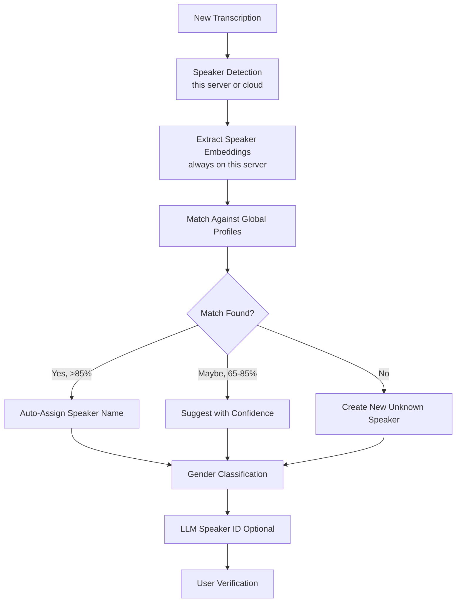

# Speaker Management

OpenTranscribe provides powerful speaker diarization and management features to identify and organize speakers across all your media files.

## Speaker Diarization

**Automatic speaker detection** identifies different speakers and segments audio by "who spoke when". It is on by default.

### Choosing who detects speakers

Speaker detection is chosen separately from transcription, under **Settings → Speaker Identification → Speaker Detection**:

- **Automatic (recommended)**: speakers are detected on this server when the built-in model transcribes, by the cloud provider when it returns speakers, and on this server when a cloud model returns text only (on a lite deployment that last case is refused; pick another option).
- **Always on this server's GPU**: this server detects speakers whichever model transcribes. Not available on a lite deployment.
- **pyannote.ai cloud service**: the audio is sent to pyannote.ai, which bills your own API key.
- **Off (one speaker for the whole recording)**: no speaker detection.

Details, timing rules and the lite limits are on [Speaker Diarization](../features/speaker-diarization.md#where-speakers-are-detected).

Detecting speakers **on this server** needs a HuggingFace token with the model agreement accepted; see [HuggingFace Setup](../installation/huggingface-setup.md). Cloud speaker detection does not.

### Turning Speaker Detection Off

Choose **Off (one speaker for the whole recording)** in **Settings → Speaker Identification → Speaker Detection** when you do not need speaker labels (dictation, voicemail, single-speaker recordings). Every segment is assigned to one speaker, and speaker profiles and cross-file matching do not run for those files; the transcript is otherwise complete. The upload dialog has no per-file switch for this.

### Re-detecting Speakers

To detect speakers again without re-transcribing, open the file's reprocess dialog and choose **Re-diarize Only (v4)**. It uses your **current** Speaker Detection choice: pyannote.ai if you chose it, otherwise this server's engine (a cloud transcription provider's own speakers cannot be fetched again without transcribing again). On a lite deployment, a re-run that would use this server's engine is refused before anything is changed. The dialog currently offers this stage only while your active transcription provider is the built-in model.

## Speaker Identification Workflow



## Speaker Profiles

### Creating Speaker Profiles

Speakers are automatically identified as "Speaker 1", "Speaker 2", etc. You can create persistent profiles:

1. Click on speaker label
2. Enter speaker name
3. Save profile

**Auto-profile creation**: When you label a speaker, OpenTranscribe automatically creates a global profile that can be matched across videos.

### Speaker Profile Avatars

Speaker profiles support profile avatars for easy visual identification. Avatars appear throughout the UI wherever speakers are displayed.

### Cross-Video Speaker Recognition

OpenTranscribe uses **voice fingerprinting** to identify the same speaker across different media files:

- Voice embeddings analyzed for similarity
- High-confidence matches auto-linked
- Speaker labels propagate across videos
- View all appearances of a speaker
- Speaker profiles are automatically shared when collections are shared with other users

### LLM-Powered Identification

An AI suggestion is only ever a suggestion. A speaker's name in search, chat, summaries and
exports comes from a name you typed or verified, or from a voice match to a profile of at least
75% similarity. An AI-suggested name never replaces the speaker label on its own, however
confident it is: it appears in the speaker editor with its confidence, and the speaker takes the
name only when you accept it.

If LLM is configured, get AI-powered speaker name suggestions based on:
- Conversation context
- Topics discussed
- Speaking patterns
- Professional role indicators

## Global Speakers Page

The dedicated **Speakers** page (accessible from the sidebar) provides a centralized view of all speaker profiles and clusters:

### Speakers Tab
- Browse all named speaker profiles
- View appearance count across files
- Edit names, avatars, and details
- Delete or merge speakers

### Clusters Tab
- **GPU-accelerated pre-clustering** groups unnamed speakers by voice similarity
- Review suggested clusters and promote them to named profiles
- **Play/pause audio** directly from cluster cards to verify speaker identity
- **Unassign and blacklist** -- remove a mis-clustered segment and prevent it from being re-assigned
- **Outlier analysis** -- identify segments that don't match the cluster well
- Trigger manual re-clustering when needed

### What removing a speaker removes

A cluster and a profile each store an average of their members' voices. When a speaker is
deleted, merged into another, unassigned or split out of a cluster, or moved to a different
profile, every cluster and profile it belonged to is rebuilt from the members that remain, so
the removed voice is not kept inside the average. A cluster left with nobody in it is deleted.
Deleting a profile removes its name from the speakers and cluster it was applied to, unless you
had given a speaker a different name yourself. If the search service is unavailable and the
cleanup cannot finish, the app reports an error (the change itself is saved) and logs it for
repair.

### What unassigning a speaker means

Unassigning a speaker from a cluster tells OpenTranscribe that this section is **not that
person**:

- The speaker leaves the cluster. If the cluster has been promoted to a named profile, the
  speaker also leaves that profile, and the name it got from the profile is removed. A name
  you typed yourself is kept.
- With **Prevent from rejoining this cluster** ticked (the default), the correction is
  remembered: the speaker is marked as "not the same person" as each speaker still in the
  cluster, and as "not this profile".
- With it unticked, the speaker still leaves the cluster and its profile, but nothing is
  remembered, so later matching may put it back.
- The cluster and the profile stay for everyone else. Their stored voice average is rebuilt
  from the speakers that remain.

Nothing automatic puts a corrected speaker back: upload-time matching, **Re-cluster All**,
voice matching after you label someone, profile suggestions, AI speaker-name suggestions and
merges all skip it, and the speaker is no longer offered that name as a suggestion. Reprocessing
the file (re-running speaker detection, re-transcribing, or retrying it) keeps the correction
too: the new speaker that holds the same stretch of audio inherits it. A bulk action that
includes a corrected speaker skips it and says so, and merging a cluster into the one the
speaker was removed from leaves that speaker where it was, with a message saying how many
stayed behind. Splitting speakers out of a cluster is treated the same way as unassigning
them: the group that moves out forms a new cluster. When you merge two speakers, the
corrections recorded on the one being merged away carry over to the speaker that remains.
Rejecting a suggested identity for a speaker counts as a correction as well.

Automatic matching also never renames a speaker that already has a name: a speaker you named,
or whose suggestion you accepted, keeps that name even if its voice sounds like someone else's
cluster. Giving a cluster member a different name (or assigning it to a different profile)
takes it out of that cluster.

To undo a correction, name that one speaker yourself: type the profile's name on it in the
transcript, or use **Accept** or **Assign to profile…** on it in the Inbox (an unassigned
speaker appears there). That clears the "not this profile" mark, and the "not the same person"
marks against that profile's speakers, for that one speaker. Bulk actions never clear it.


### Gender Classification

OpenTranscribe can automatically detect speaker gender attributes:

- **Gender badges** displayed on speaker profiles and cluster cards
- Used for **gender-informed cluster validation** -- prevents merging speakers of different detected genders
- Configure in **Settings → Speaker Identification → Voice Attributes**
- Gender detection runs during the diarization pipeline

## Speaker Analytics

View comprehensive speaker statistics:

- **Talk Time**: Total speaking duration
- **Word Count**: Words spoken
- **Turn-Taking**: Number of speaking turns
- **Interruptions**: Detected interruptions
- **Speaking Pace**: Words per minute
- **Question Frequency**: Questions asked
- **Cross-Media Appearances**: Videos featuring speaker

## Managing Speakers

### Edit Speaker Labels

1. Click speaker name in transcript
2. Type the real name in the field at the top of the menu and press Enter (or the check button)
3. Changes apply to all segments

As you type, matching [speaker profiles](#speaker-profiles) are listed under the field; pick one to use that name. A name like `SPEAKER_01` is rejected, because those are reserved for the automatic labels.

The menu's **New speaker for this segment…** option is a different action: it creates an additional speaker and assigns only the segment you clicked to it. Use it when a segment was attributed to the wrong person, not to name the speaker you already have.


### Jump-to-Timestamp in Speaker Editor

The speaker editor includes jump-to-timestamp links next to each segment ([#147](https://github.com/attevon-llc/OpenTranscribe/issues/147)):

- Click the timestamp badge next to any segment in the speaker editor to jump the media player to that moment
- Useful for quickly verifying speaker assignments by listening to the actual audio
- Works for both named profiles and unnamed clusters

### Merge Speakers

If diarization incorrectly splits one speaker:

1. Select segments
2. Assign to same speaker profile
3. Consolidate analytics

### Speaker Verification Status

Track speaker identification confidence:
- ✅ Verified: Manually confirmed
- AI Suggested: LLM identification
- Auto-Matched: Voice fingerprint match
- Unverified: Default detection

## Configuration

### Adjust Speaker Detection Range

Set the number of speakers to expect in **Settings → Speaker Identification → Speaker Detection → Number of speakers** (1 to 50), or per file in the upload wizard's **Speakers** step and the reprocess dialog. An administrator sets the system default range in `.env`:

```bash
# .env configuration (system default range)
MIN_SPEAKERS=1
MAX_SPEAKERS=20
```

**Note**: the range is a hint. pyannote.ai and the in-process PyAnnote engine apply it, and a cloud provider applies whatever part of it that provider supports. The default diar-native engine on this server counts speakers automatically and ignores it.

### Speaker Display Preferences

Customize in UI settings:
- Color coding by speaker
- Show/hide speaker analytics
- Filter by speaker
- Export with speaker labels

## Troubleshooting

### All Speakers Shown as "Speaker 1"

**Causes**:
- Speaker Detection is set to **Off** (every segment gets one speaker)
- Single speaker in audio
- Poor audio quality
- For detection on this server: HuggingFace token not configured

**Solutions**:
- Check **Settings → Speaker Identification → Speaker Detection**, then re-detect speakers (see [Re-detecting Speakers](#re-detecting-speakers))
- Check audio has multiple speakers
- Ensure clear audio quality
- Verify [HuggingFace setup](../installation/huggingface-setup.md)

### Too Many/Few Speakers Detected

**Solutions**:
- Set a speaker range or exact count for the file when you upload or reprocess it. This has an effect only with a detector that uses the range (see the note under [Adjust Speaker Detection Range](#adjust-speaker-detection-range)).
- Merge duplicate speakers manually.

### Speaker Segments Fragmented

**Cause**: Diarization split one speaker into multiple

**Solution**: Manually merge segments to same profile

## Best Practices

1. **Label Important Speakers**: Create profiles for frequent speakers
2. **Verify AI Suggestions**: Review LLM-suggested names
3. **Use Consistent Names**: Maintain naming convention
4. **Review Cross-Video Matches**: Confirm auto-matched speakers
5. **Adjust Detection Range**: Set your speaker range for your use case, where the detector uses it

## Next Steps

- [First Transcription](../getting-started/first-transcription.md)
- [AI Summarization](./ai-summarization.md)
- [Search & Filters](./search-and-filters.md)
