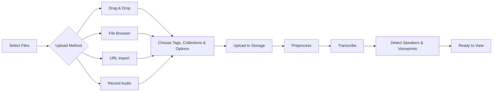

# Uploading Files

Learn how to upload and process media files in OpenTranscribe.

## Supported Formats

Every format below is accepted and transcribed, and the original file is always kept for
download. What differs is how the file plays in the browser:

| Group | Formats | In the player |
|---|---|---|
| Plays in your browser | MP3, WAV, FLAC, OGG, Opus, AAC, M4A, WebM, MP4, MOV, MKV | The original plays as uploaded. |
| Plays after automatic conversion | AIFF, WMA, ALAC (in M4A), AMR, AC-3, MP2 | Browsers can't decode these, so a playable AAC copy is made in the background while the file transcribes. |
| Transcribed, audio-only preview | AVI, WMV, MPEG, MPEG-TS, FLV, 3GP | Browsers can't show the picture. The player plays the audio track and says the video preview is unavailable. |

"Plays in your browser" was measured in Firefox and Chromium: a format counts only if both
played it with sound and, for video, with a picture. A video in MP4, MOV or MKV whose
*picture codec* no browser decodes (for example MPEG-4 Part 2, ProRes or Theora) also gets
the audio-only preview.

Files uploaded before playback conversion existed get their playable copy the next time
they are reprocessed.

## Upload & Processing Workflow



## How Your Files Are Processed

Every recording goes through the same steps: **transcription** (the words), **speaker
detection** (who spoke when), **voiceprints** (used to recognise the same voice in other
recordings) and, if an AI provider is set up, **AI features** such as summaries, topics and
speaker name suggestions. You choose who does the first two in Settings; voiceprints are always
computed on this server.

### Choosing who transcribes and who detects speakers

Open **Settings** and look under **Transcription & Speakers**:

- **Transcription → Provider & Model** chooses who transcribes: the built-in model on this
  server, or a cloud provider you have configured. The other tabs (**Language**,
  **Vocabulary**, **Accuracy & Cleanup**) tune how it transcribes.
- **Speaker Identification → Speaker Detection** chooses who detects speakers. The
  **Speaker detection** list offers:

  | Option | What it does |
  |---|---|
  | **Automatic (recommended)** | With the built-in model, speakers are detected on this server. With a cloud provider, that provider detects speakers, or this server does when the model returns text only. |
  | **Always on this server's GPU** | Speakers are detected on this server whichever model transcribes. |
  | **pyannote.ai cloud service** | Audio is sent to pyannote.ai to detect speakers. It needs your own pyannote.ai API key, and pyannote.ai bills that key. This is not the PyAnnote engine an administrator can pick for this server. |
  | **Another provider's speaker detection** | A saved provider that returns speakers labels who spoke. It transcribes every recording in full and receives the audio; only its speaker labels are used. |
  | **Off (one speaker for the whole recording)** | No speaker detection. Speaker profiles and cross-file speaker matching do not run. |

Some combinations cannot work, for example a cloud model that returns no timestamps together with
any speaker detection, or pyannote.ai without a saved key. OpenTranscribe refuses such a choice
when you save it and explains why, and a file that would hit one is stopped before processing
starts, with the same explanation as its error message.

:::info[Cloud-only (lite) deployments]
A lite deployment has no local transcription and no local speaker detection. Choose a cloud
provider for transcription, and either a cloud model that returns speakers or pyannote.ai for
speaker detection. Voiceprints are still computed on the server. See
[Deployment Variants](../installation/deployment-variants.md).
:::

### The processing pipeline summary

**Settings > Transcription & Speakers > Processing pipeline** is a read-only summary of how your
next recording will be processed. It lists the four steps (transcription, speaker detection, speaker identification
with voiceprints, and AI features), says where each one runs (this server or a named cloud
provider), and lists any problem with your current choices together with a link to the setting
that fixes it. It changes nothing; it reflects your settings.

### What happened to a particular file

Each file records how it was actually processed. Open the file and expand the **Processing**
section (next to **File Details**), or open **My Files Status** and click **Details** on a file.
One row per step:

| Row | Shows |
|---|---|
| **Transcription** | The provider and model, and whether it ran on **This server** or in the **Cloud** |
| **Speaker detection** | Who detected speakers and where (or **Off**) |
| **Voiceprints** | The voiceprint engine or model, always on **This server** |
| **Summary**, **Topics**, **Speaker name suggestions** | The AI provider and model used, and where it ran |

The transcription row also shows the timing the transcript has (**Word timing**, **Segment
timing** or **No timing**). A step that did not run says **Not run** or **Off**. Files processed
before OpenTranscribe started keeping this record show what the older records can say and
**Not recorded (processed before this was tracked)** for the rest, rather than a guess; where an
old record cannot tell whether speakers were detected on this server or by pyannote.ai, the row
says **Location not recorded**.

## Upload Methods

Click **Add Media** (top right of the gallery toolbar) to open the upload dialog. It is a short
stepper: **Media**, **Tags** and **Collections** (both optional), **Options** (transcription model and
the AI summary switch), **Speakers** (the expected speaker range; skipped when speaker detection is
off or the Fast model is chosen) and **Review**. A large video adds an **Extract** step. Use **Review
with defaults** to skip ahead with your saved settings. The first step has three tabs, **Upload File**,
**Media URL** and **Record Audio**.

### Drag & Drop
1. Open **Add Media** and drag files onto the drop zone
2. Multiple files supported
3. Optionally add tags and collections (see below)
4. Click **Upload**; processing is queued automatically


### File Browser
1. Click **Add Media**, then click the drop zone to browse
2. Select file(s)
3. Optionally add tags and collections (see below)
4. Click **Upload**

### Large videos: audio extraction

When a video is larger than your threshold, the upload dialog adds an **Extract** step offering
**Extract Audio** (recommended) or **Upload Full Video**. Extraction runs in your browser before
anything is sent, so only the much smaller audio track is uploaded. Turn it on or off, set the
**File Size Threshold**, and choose whether to be asked each time under **Settings > Audio Extraction**.

### Media URL (1800+ Platforms)
1. In **Add Media**, open the **Media URL** tab and paste the video URL
2. Supported: YouTube, Dailymotion, Twitter/X, TikTok, Vimeo, and 1800+ more
3. Auto-downloads in web-compatible format and processes


**Best supported platforms:**
- YouTube (including playlists)
- Dailymotion
- Twitter/X

**Limited support** (may require authentication):
- Vimeo, Instagram, Facebook, TikTok

:::tip[Platform Guidance]
If a video fails to download, OpenTranscribe provides helpful error messages with platform-specific suggestions. Common issues include:
- **Authentication required** - Video requires login (try YouTube or Dailymotion instead)
- **Age/geo-restricted** - Content blocked in your region
- **Premium content** - Requires subscription on source platform
:::

### URL Download Quality Settings

You can configure download quality preferences in **Settings → URL Import Quality**:

- **Video Quality**: Choose resolution (e.g., 1080p, 720p, 480p, or best available)
- **Audio Only**: Download only the audio track (faster, saves storage)
- **Audio Quality**: Select audio bitrate when downloading audio only

You can also override these defaults per-download with **Download Options** in the **Media URL** tab.

## Organizing During Upload

When uploading files, you can assign them to **tags** and **collections** directly in the upload dialog:

1. On the **Tags** step, select existing tags or type new tag names
2. On the **Collections** step, select one or more existing collections or click **Create collection**
3. Both steps are optional and can be skipped
4. Upload the file -- it will be organized automatically

This saves time compared to organizing files after upload. Tags and collections can also be managed later from the file detail page.

:::tip[Auto-Labeling]
If auto-labeling is enabled (Settings → AI & Chat → Auto-Labeling), OpenTranscribe can automatically suggest tags and collections based on AI topic analysis after transcription completes. See [AI Summarization](./ai-summarization.md#auto-labeling) for details.
:::

## Selective Reprocessing

Already-transcribed files can be reprocessed with a stage picker that lets you run only specific stages:

1. Open a file's detail page
2. Click **Reprocess** (or select multiple files in the gallery and use bulk reprocess)
3. Choose which stages to re-run:
   - **Transcription & Diarization** -- Full re-transcription with speaker detection, using your current transcription and speaker detection settings. Replaces all transcript data.
   - **Re-diarize Only (v4)** -- Re-run speaker detection on the existing transcript text without re-transcribing. It uses your current **Speaker detection** choice; when that choice is the transcription provider's own speakers (or Off), speakers are detected on this server instead, because a provider's speakers cannot be re-run without transcribing again. Needs word-level timestamps.
   - **Search Indexing** -- Rebuild the search index entry
   - **Analytics** -- Recalculate speaker analytics
   - **Speaker Identification (AI)** -- Re-run AI speaker name suggestions
   - **AI Summary** -- Regenerate AI summary
   - **Topic & Tag Extraction** -- Re-run AI topic analysis
4. Optionally adjust speaker settings (min/max speakers)
5. Confirm and process

This is useful when you want to update just the summary with a new prompt without re-transcribing, or re-detect speakers with different speaker count settings.

If a re-run cannot work with your current settings (for example, re-detecting speakers on this
server in a cloud-only deployment), it is refused before anything is deleted, with an
explanation.

## Export Options

OpenTranscribe supports multiple export formats accessible from the **Export** dropdown on any completed transcript page: Plain Text (.txt), JSON Format (.json), CSV Format (.csv), SubRip Subtitles (.srt), WebVTT Subtitles (.vtt), Markdown (.md), Word Document (.docx) and PDF Document (.pdf). You can also bulk-export subtitles across multiple files.

Every format applies your content redaction settings and any administrator export floor, so a masked word is masked in the file too. See [Content Redaction](../features/content-redaction.md).

### TXT -- Plain Text

A configurable plain-text export. When you choose TXT, a dialog lets you toggle what to include:

- **Timestamps** -- Segment start/end times in `[MM:SS - MM:SS]` format
- **Speaker names** -- Speaker labels before each segment
- **Comments** -- User-added comments inline

Your preferences are remembered for future exports. Consecutive segments from the same speaker are automatically merged for readability. Overlapping speech is formatted as a special block:

```
[02:15 - 02:20] OVERLAPPING SPEECH:
  Alice (02:15 - 02:18): That's a great idea but--
  Bob (02:16 - 02:20): I completely disagree!
```

### JSON -- Structured Data

Exports the full transcript as a JSON file containing:
- Every segment with `start_time`, `end_time`, `text`, and `speaker_id`
- Speaker metadata and display names
- Word-level timestamps (when available)

Useful for programmatic analysis, importing into other tools, or building custom reports.

### CSV -- Spreadsheet Format

Exports segments as comma-separated values with columns for timestamp, speaker, and text. Open directly in Excel, Google Sheets, or any spreadsheet application for sorting, filtering, and analysis.

### SRT -- SubRip Subtitles

Industry-standard subtitle format compatible with virtually all video players (VLC, MPC, Plex, etc.). Features:
- Movie-style formatting with 42-character line wrapping
- Optimal display timing based on reading speed (200 WPM)
- Speaker labels included by default (toggle with the include speakers option)
- Overlapping speech merged into single cues with speaker attribution
- Long segments automatically split into readable subtitle blocks

### VTT -- WebVTT Subtitles

Web Video Text Tracks format for HTML5 video players and web applications. Same formatting as SRT but uses the WebVTT standard (dots instead of commas in timestamps, `WEBVTT` header).

### Markdown -- Notes and Knowledge Bases

Exports the transcript as a `.md` file for note-taking tools such as Obsidian or Logseq. The file starts with YAML front matter (title, language, participants, the export date and whether the text is redacted), followed by one block per speaker turn with the speaker name and a `[HH:MM:SS]` timestamp. Text that would otherwise be read as Markdown structure, such as a line starting with `#` or `---`, is escaped so it stays plain text. Markdown downloads immediately, like TXT.

### Word and PDF -- Documents You Can Cite

**Word Document (.docx)** and **PDF Document (.pdf)** produce a printable transcript with numbered lines, for legal, research and compliance work where you need to point at "page 3, line 12".

Choosing either opens **Document Export Options**:

- **Include timestamps** and **Include speaker names**, the same switches as TXT. Speaker names are unavailable for a file with no speaker data.
- **Include user comments**, shown only when the file has comments. Comments are printed inline where they were made.
- **Line numbers**: **Restart on each page** (the default, so a citation reads page and line), **Continue through the document**, or **No line numbers**.
- **Page size**: **A4** or **US Letter**.

Your choices are remembered in this browser. The file is built on the server by a background job, so the Export button reads **Preparing document...** and the download starts when it is ready. A long transcript takes longer, and a four-hour recording can take around a minute for the scripts that need the most layout work.

Both documents carry a header with the file title and export date, a **Redacted** marker when any text is masked, and **Page N of M** in the footer.

**Which to choose:**

| | PDF | Word |
|---|---|---|
| Page and line numbers | Fixed: every page has exactly 25 numbered lines, on A4 and Letter alike, so a citation means the same thing for everyone | Native Word line numbering, laid out by Word, so numbers can differ from the PDF |
| Editing | Not editable | Editable |
| Fonts | The needed Noto fonts are embedded (only the characters used) | Named, not embedded: the viewer's machine needs Noto fonts or Word substitutes another |
| Speaker header | A speaker's header line never ends a page on its own | Follows Word's pagination |

Cite from the PDF when the citation must be stable; use Word when you need to edit the text.

**Languages.** Arabic and Hebrew are laid out right to left, and the direction is chosen per turn from its text, not from the interface language, so an Arabic turn in an English session reads correctly. Arabic, Indic scripts and Thai are shaped properly. Chinese, Japanese, Korean and Thai lines can break between any two characters because OpenTranscribe has no dictionary for them, so a line may end mid-word and the usual rule that a line must not start with a closing mark is not applied. The Chinese, Japanese or Korean typeface follows the file's language, and Traditional Chinese is used for Traditional markers such as `zh-TW`.

**When it cannot be built.** A toast explains the reason:

| Message | Meaning |
|---|---|
| Content redaction has not finished for this file | Your policy masks text and the scan is still running. Try again when detection completes. |
| This transcript is too long to export as a document | The transcript lays out to more than 60,000 lines. Export TXT or split the recording. |
| The document export is temporarily unavailable | The redaction policy could not be read, so the export was withheld rather than risk leaking text. Try again shortly. |
| The fonts needed to build this document are not installed on this server | A PDF needs the Noto fonts shipped in the backend image. Ask your administrator. |
| The document could not be built | Any other failure. Try again; the server log has the cause. |

Administrators: see [Document export](../features/document-export.md) for the capability switch, fonts and licences.

### Bulk Export

Export subtitles for multiple files at once:
1. Click **Select Files** in the gallery and tick the files
2. Open the **Organize** menu
3. Choose **Export SRT**, **Export WebVTT** or **Export Text**
4. Files are bundled into a single **ZIP download**

Up to 100 files can be exported in a single bulk operation. Files that are not yet completed are automatically skipped.

Bulk subtitle export is **asynchronous**: the ZIP is built on the download worker while live progress streams to the browser over SSE, then delivered via a short-lived presigned URL -- rather than a synchronous download that blocks until the archive is ready.

### Video Download with Embedded Subtitles

When downloading a video file, OpenTranscribe automatically embeds subtitles using FFmpeg:
- Subtitles are added as a soft subtitle track in the downloaded MP4
- Speaker labels are included by default
- Open the **Download** menu on the transcript actions bar: **Video with subtitles**, **Original video** (without embedded subtitles), or audio as **MP3**, **WAV** or **Original**

---

## File Management

### Editing File Metadata

After upload, you can update a file's metadata from the detail page:

1. Click on a file to open the detail view
2. Click the **title** at the top to edit it inline
3. Press **Enter** (or click the save icon) to save, or **Escape** to cancel

The **title** is the display name shown in the gallery and search results (it also updates the search index).

### File Status Tracking

Each file has a status indicating its current state:

| Status | Description |
|--------|-------------|
| `pending` | File uploaded, waiting to be queued |
| `queued` | In the processing queue |
| `downloading` | URL-sourced file is being downloaded |
| `processing` | Transcription or speaker detection in progress |
| `completed` | Processing finished successfully |
| `error` | Processing failed (check the error message for details) |
| `cancelling` | Cancellation requested, waiting for worker |
| `cancelled` | Processing was cancelled by the user |
| `orphaned` | Processing appears stuck with no active worker |

Each file card in the gallery shows its status inline. For a summary of everything that is
processing, open **Settings → System → File status** (counts, the files that need attention and
the last 24 hours of uploads); **Open full screen** there opens the full **My Files Status** page
(`/file-status`) with the task list, filters and per-file details. There is no File Status button in
the main navigation.

You can view detailed status information -- including active task ID, last error message, and retry count -- via the **status detail** panel on the file page. **My Files Status** → **Details** also shows how the file was processed; see [What happened to a particular file](#what-happened-to-a-particular-file).

A file whose processing could not work with your settings (for example a choice this deployment
cannot run) goes straight to `error` with a plain explanation of which setting to change. Fix
the setting under **Settings → Transcription** or **Settings → Speaker Identification**, then
retry.

### Bulk Operations

Click **Select Files** in the gallery toolbar, tick files (or **Select all**), then use the selection toolbar. It groups actions into a **Process** menu, an **Organize** menu and a **Delete** button:

| Menu | Action | Description |
|------|--------|-------------|
| **Process** | **Reprocess** | Re-run processing; opens the stage picker so you can choose which stages to re-run |
| **Process** | **AI chat with N** | Start a chat scoped to the selected completed recordings (see [Chatting with Your Transcripts](./chatting-with-transcripts.md)) |
| **Process** | **Summarize** | Generate AI summaries for the selected files |
| **Process** | **Redact** | Run content-redaction detection on the selected completed files |
| **Process** | **Retry Failed** | Retry files that failed processing |
| **Process** | **Speaker ID** | Run AI speaker identification on the selected completed files |
| **Process** | **Cancel Processing** | Cancel active transcription tasks |
| **Organize** | **Add to Collection** | Add the files to a collection |
| **Organize** | **Add or Edit Tags** | Apply a tag to all selected files (see [Tags](./tags.md)) |
| **Organize** | **Export SRT / Export WebVTT / Export Text** | Bulk export transcripts as a ZIP |
| (button) | **Delete N selected** | Delete the files and their data; only a file's owner or an organization admin can delete a file |

Administrators also see **Quarantine** in the Organize menu (see the [Admin Panel](./admin-panel.md)). All bulk operations report per-file success/failure results.

### Recovering Stuck or Failed Files

If a file is stuck in `processing` status or has failed:

1. **Check the status detail** -- Open the file, or open **Settings > System > File status** and click **Details**, and read the error message and recommendations
2. **Retry** -- Click **Retry** on a file listed under **Files That Need Attention** in **My Files Status**, or select failed files in the gallery and choose **Retry Failed** from the **Process** menu
3. **Cancel and retry** -- For stuck processing files, select them and choose **Cancel Processing** from the **Process** menu, then **Retry Failed**
4. **Recover** -- Click **Request Recovery for All** in **My Files Status** to attempt automatic recovery of stuck files
5. **Force delete** (admin only) -- Deleting files that are still processing offers to cancel their processing and delete them (**Force Delete Processing Files**)

The system automatically detects stuck files (processing longer than the threshold, default 2 hours) and provides recovery recommendations.

:::info[Admin Tools]
Administrators have access to additional file management capabilities:
- **Stuck files report** -- View all files stuck in processing beyond a configurable threshold
- **Cleanup orphaned files** -- Bulk recover or mark files that lost their worker connection
- **Reset retry count** -- Allow re-processing beyond the normal retry limit
:::

---

## Speaker Analytics

Once a file completes processing, OpenTranscribe computes detailed analytics automatically (or on-demand if missing). View analytics in the **Analytics Overview** section of the file detail page (below the transcript actions bar).

### Talk Time

- **Per-speaker talk time** in seconds and as a percentage of total duration
- **Total talk time** across all speakers

### Word Count

- **Word count** per speaker and overall total

### Interruptions

- **Interruption count** per speaker -- detected when a new speaker begins before the previous speaker finishes
- **Total interruptions** across the conversation
- Helps identify dominant speakers or heated discussions

### Turn-Taking

- **Turn count** per speaker -- number of times each speaker takes the floor
- **Total turns** in the conversation
- Reveals participation balance and conversation dynamics

### Questions

- **Question count** per speaker -- detected by segments ending with `?`
- **Total questions** asked during the conversation

### Refreshing Analytics

If speaker names are updated or segments are edited, you can recalculate analytics by selecting **Analytics** as a stage when you **Reprocess** the file.

---

## Recording Audio

Record audio directly in your browser without any external software:

### Starting a Recording

1. Click **Add Media** and open the **Record Audio** tab
2. Grant microphone permission when prompted by your browser
3. **Select your microphone** from the **Microphone Device** dropdown (if you have multiple)
4. Click **Start Recording**

### During Recording

- **Audio level meter** shows real-time volume so you can verify your microphone is working
- **Duration counter** displays elapsed recording time
- **Pause/Resume** the recording at any time without losing progress
- Recording format: WebM with the Opus codec. Quality (**Standard**, **High** or **Maximum**), the maximum duration and auto-stop are set under **Settings > Recording Settings**

### Finishing a Recording

1. Click **"Stop"** when you are finished
2. The recorded audio is automatically uploaded to OpenTranscribe
3. Standard transcription processing begins immediately

:::tip[Recording Quality]
For best results, use an external microphone rather than a built-in laptop mic. Ensure your environment is quiet and speak clearly. Monitor the audio level indicator to confirm your voice is being captured.
:::

:::note[Browser Support]
Recording requires a modern browser with MediaRecorder API support (Chrome, Firefox, Edge, Safari 14.1+). Your browser must have permission to access the microphone.
:::

## Upload Manager

Floating upload manager shows:
- Upload progress
- Queue position
- Processing status
- Error messages

## Next Steps

- [First Transcription](../getting-started/first-transcription.md)
- [Speaker Management](./speaker-management.md)
